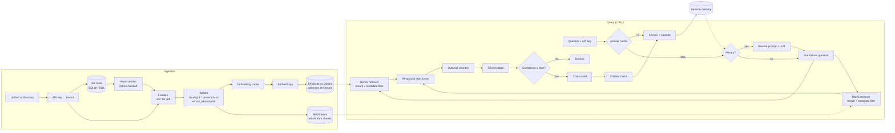

# langchain-rag-service

A FastAPI service for retrieval-augmented generation (RAG) built on LangChain runnables.
You give it Markdown, text or PDF files; it splits them into chunks and indexes them in
a vector store (FAISS or Qdrant) and in BM25. Questions are answered from the retrieved
chunks, with numbered citations that are checked against the sources. Answers can be
streamed over Server-Sent Events, and follow-up questions in a session are rewritten
into standalone questions before retrieval.

Around that core the service has:

- **Tenants and API keys.** Each API key belongs to a tenant; every tenant has its own
  index, and every query is filtered on the tenant id stored with each chunk.
- **Background ingestion.** Uploads can be queued as jobs in a SQL table and processed
  by an asyncio worker with retries and idempotency by content hash.
- **Re-ranking.** An optional second stage scores retrieved candidates with a lexical
  scorer, the chat model, or a sentence-transformers cross-encoder.
- **Guardrails.** A token budget for the context, a retrieval-confidence floor below
  which the service declines, and validation of every `[n]` citation.
- **Caching.** Embeddings and complete answers in Redis, or in process memory when
  Redis is not configured or not reachable.
- **Observability.** Prometheus metrics, OpenTelemetry spans and JSON logs that carry a
  request id.

It runs with no API keys and no external services: the default `fake` provider uses
deterministic hashing embeddings and an extractive stand-in for the chat model, FAISS
is the default vector store, and the cache falls back to memory. The API, the test suite
and the evaluation all run offline. Set `RAG_PROVIDER=openai` to use an
OpenAI-compatible endpoint, either OpenAI itself or a local Ollama server.

## Architecture



The query side is a composition of LangChain runnables:

- `build_rewrite_chain`: a `RunnableBranch` that returns the question unchanged on the
  first turn and runs `rewrite_prompt | llm | StrOutputParser` when there is history.
- `build_retrieval_chain`: assigns `standalone_question`, then `documents` (retriever
  followed by the token budget), then `confidence`.
- `build_answer_chain`: renders the documents into numbered `<source>` blocks, then
  `answer_prompt | llm | StrOutputParser`. A branch returns a fixed "not found" reply
  without calling the model when retrieval returned nothing or confidence is below the
  floor.
- `build_rag_chain`: retrieval, answer, then the guardrail review of the citations.

The streaming endpoint runs the retrieval chain, sends the sources, streams the answer
chain with `astream`, and reports the citation review in the final event.

## Running locally

Requires Python 3.11 or newer.

```bash
python -m venv .venv
source .venv/bin/activate          # Windows: .venv\Scripts\activate
pip install -e ".[dev]"

RAG_INGEST_ON_STARTUP=data/docs rag-service
```

The service listens on `http://127.0.0.1:8000`; interactive docs are at `/docs`.
`RAG_INGEST_ON_STARTUP` ingests the sample corpus when the service starts. Sources that are
already indexed with identical content are skipped, so restarts do not re-embed them.

```bash
# Ingest files synchronously, or queue them as a background job
curl -F "files=@notes.md" -F "files=@manual.pdf" http://127.0.0.1:8000/ingest/files
curl -F "files=@notes.md" http://127.0.0.1:8000/jobs/ingest
curl http://127.0.0.1:8000/jobs/<job id>

# Ingest a directory below RAG_INGEST_ROOT
curl -X POST http://127.0.0.1:8000/ingest/directory \
     -H "Content-Type: application/json" -d '{"path": "docs"}'

# Ask a question, optionally restricted by metadata
curl -X POST http://127.0.0.1:8000/query \
     -H "Content-Type: application/json" \
     -d '{"question": "What value is the RRF constant k commonly set to?",
          "session_id": "demo", "filters": {"source": ["rank-fusion.md", "glossary.txt"]}}'

# Stream the answer
curl -N -X POST http://127.0.0.1:8000/query/stream \
     -H "Content-Type: application/json" \
     -d '{"question": "What does the BM25 parameter k1 control?"}'
```

### Endpoints

| Method | Path | Purpose |
| --- | --- | --- |
| `GET` | `/health` | Provider, vector store, retriever mode, whether auth is on, loaded tenants and chunks |
| `GET` | `/metrics` | Prometheus metrics |
| `POST` | `/ingest/files` | Multipart upload of `.md`, `.markdown`, `.txt` or `.pdf` files, ingested before the response |
| `POST` | `/ingest/directory` | Ingest a directory below `RAG_INGEST_ROOT` (`{"path": "docs"}`) |
| `POST` | `/jobs/ingest` | Queue an upload for background ingestion (`202`, or `200` with the existing job) |
| `GET` | `/jobs` | The tenant's recent jobs (`?limit=`) |
| `GET` | `/jobs/{id}` | Status, attempts, error and result of one job |
| `GET` | `/documents` | Chunk count per source |
| `DELETE` | `/documents/{source}` | Remove one source from the index |
| `POST` | `/query` | Answer a question; returns JSON |
| `POST` | `/query/stream` | Answer a question as Server-Sent Events |
| `GET` | `/sessions/{id}` | Messages stored for a session |
| `DELETE` | `/sessions/{id}` | Forget a session |

`/health` and `/metrics` never require a key; with keys configured every other endpoint
does, and acts on the caller's tenant only.

`/query` and `/query/stream` accept `question`, an optional `session_id`, and optional
per-request overrides `k`, `retriever_mode` (`dense`, `bm25`, `hybrid`), `search_type`
(`similarity`, `mmr`), `rerank` (`false` skips the configured reranker) and `filters`.
`filters` maps metadata keys to a value or a list of accepted values, for example
`{"source": ["bm25.md", "mmr.md"], "page": 3}`; values must be strings, integers or
booleans, and `tenant_id` cannot be used.

The JSON response contains:

| Field | Meaning |
| --- | --- |
| `answer`, `standalone_question` | The (checked) answer and the question used for retrieval |
| `sources` | Chunks that were in the prompt: citation `id`, `source`, `page`, `chunk_id`, `start_index`, `score` (RRF or BM25), `rerank_score`, `snippet` |
| `confidence` | Retrieval confidence in [0, 1] (see [Guardrails](#guardrails)) |
| `citations` / `invalid_citations` | Cited source ids, and cited numbers that matched no source |
| `refusal` | `no_documents`, `low_confidence`, `invalid_citations`, `not_in_sources` or `null` |
| `cached` | Whether the answer came from the answer cache |

The stream sends these events, each with a JSON `data` field:

| Event | Data |
| --- | --- |
| `sources` | `question`, `standalone_question`, `sources`, `confidence` |
| `token` | one chunk of answer text (a cached answer arrives as a single token) |
| `done` | `answer` (checked), `session_id`, `citations`, `invalid_citations`, `refusal`, `cached` |
| `error` | `detail`, sent if generation fails after the stream started |

Tokens are streamed as the model produces them, so an invalid citation removed by the
`strip` policy is still visible in the `token` events; `done.answer` is the checked
text and is what the session history stores. Querying an empty index returns
`409 Conflict`.

## Tenants and API keys

`RAG_API_KEYS` is a JSON object mapping the SHA-256 hex digest of each key to a tenant
id. Only digests are configured, never keys. `rag-apikey` creates a key and prints the
entry to add:

```bash
$ rag-apikey new acme
api key (give to the client):   rag_6vK...
RAG_API_KEYS entry (configure): "9f2c...": "acme"

$ export RAG_API_KEYS='{"9f2c...": "acme", "41d0...": "globex"}'
$ curl -H "X-API-Key: rag_6vK..." http://127.0.0.1:8000/documents
$ curl -H "Authorization: Bearer rag_6vK..." http://127.0.0.1:8000/documents
```

Keys are compared by digest with `hmac.compare_digest` against every configured entry.
A plain SHA-256 is adequate for long random keys like the ones `rag-apikey` generates;
it would not be for passwords people choose.

With `RAG_API_KEYS` empty, authentication is off, every request belongs to
`RAG_DEFAULT_TENANT`, and the service logs a warning at startup.

Isolation is enforced at three levels:

1. **Separate indexes.** FAISS indexes live in `<RAG_INDEX_DIR>/<tenant>`; Qdrant
   collections are named `<RAG_QDRANT_COLLECTION_PREFIX><tenant>`.
2. **Stamped chunks.** Every chunk is written with `tenant_id` in its metadata.
3. **Enforced filter.** Every retrieval adds `tenant_id == <caller's tenant>` to the
   dense and the BM25 search, replacing anything the client sent.

Session ids and job ids are scoped by tenant too. An index written before tenancy
existed (files directly in `RAG_INDEX_DIR`) is moved into the default tenant's folder
on startup and its chunks are stamped with that tenant.

## Background ingestion

`POST /jobs/ingest` validates the file names and types, writes the files to the job
table and returns `202 Accepted` with the job and a `Location` header. A worker task in
the API process claims due jobs one at a time and ingests them in a thread.

- **Storage.** The table is in SQLite at `<RAG_INDEX_DIR>/jobs.sqlite3` (WAL mode) unless
  `RAG_JOBS_DATABASE_URL` points at another SQLAlchemy database. The code only uses
  portable SQL, but only SQLite is exercised by the tests; the `postgres` extra installs
  `psycopg` for a PostgreSQL URL.
- **Claiming.** A job is claimed with `UPDATE ... SET status='running' WHERE id=? AND
  status='queued'`, so two workers sharing one database never run the same job.
- **Retries.** Errors that may be transient (for example an unreachable embedding
  endpoint) requeue the job after `RAG_JOB_RETRY_BACKOFF_SECONDS * 2^(attempt-1)`
  seconds, up to `RAG_JOB_MAX_ATTEMPTS`. Files that cannot be parsed fail at once.
- **Idempotency.** A job is identified by its tenant and a SHA-256 over the uploaded
  names and contents. Re-submitting the same upload while its job is queued, running,
  or succeeded within `RAG_JOB_IDEMPOTENCY_SECONDS` returns that job with `200`. A
  unique column enforces this across processes. A failed job does not block a retry.
- **Restarts.** Jobs left `running` by a stopped process are requeued when the worker
  starts. `RAG_INGEST_WORKER=false` accepts jobs without processing them in that process.

## Vector stores

`RAG_VECTOR_STORE` selects the backend. Both keep a BM25 index over the same chunks in
memory, and both apply metadata filters on the dense side and the BM25 side.

- **`faiss`** (default): a FAISS index per tenant on disk. Writes update a copy of the
  index and swap in an immutable snapshot, so a request keeps the snapshot it started
  with.
- **`qdrant`**: a collection per tenant, written through `langchain-qdrant`.
  `RAG_QDRANT_URL` is a server URL, or `:memory:` for an in-process store; unset means
  an on-disk local store under `<RAG_INDEX_DIR>/qdrant`. Metadata filters become payload
  conditions on `metadata.<key>`, and keyword payload indexes are created for
  `tenant_id` and `source`. A small `<prefix>meta` collection records each collection's
  embedding model and a content version; every replica checks that version at most
  every `RAG_QDRANT_SYNC_SECONDS` and reloads its BM25 copy of the chunks when another
  replica has written.

## Re-ranking

With `RAG_RERANKER` set, the retriever fetches `RAG_RERANK_CANDIDATES` chunks and the
reranker keeps the best `k`; each source then has a `rerank_score` in [0, 1].

| `RAG_RERANKER` | How it scores |
| --- | --- |
| `none` | No re-ranking (default) |
| `lexical` | IDF-weighted share of the query's words present in the chunk (weight 0.8) plus the share of query bigrams present (0.2); no model calls |
| `llm` | Asks the chat model for a 0-10 grade per chunk, `RAG_RERANK_MAX_CONCURRENCY` calls at a time; a reply without a number falls back to the lexical score |
| `cross-encoder` | A sentence-transformers `CrossEncoder` (`RAG_CROSS_ENCODER_MODEL`), logits squashed with a sigmoid; needs `pip install ".[rerank]"` |

The fake chat model answers the grading prompt with the share of query words found in
the chunk, so the `llm` path runs offline, though it then measures word overlap rather
than relevance.

## Guardrails

- **Token budget.** Retrieved chunks enter the prompt in rank order while their rendered
  `<source>` blocks fit `RAG_MAX_CONTEXT_TOKENS` (default 3000); a chunk that does not
  fit is skipped, and if none fits the best one is truncated. Tokens are counted with
  tiktoken (`RAG_TOKENIZER_ENCODING`, default `cl100k_base`). If the encoding cannot be
  loaded (tiktoken downloads it on first use), counting falls back to one token per four
  characters and a warning is logged. The Docker image downloads the encoding at build
  time. The response's `sources` are exactly the chunks in the prompt.
- **Confidence floor.** Confidence is the best `rerank_score` when re-ranking ran,
  otherwise the largest share of the question's distinct words (after stop-word removal)
  found in any one chunk. Below `RAG_MIN_RETRIEVAL_CONFIDENCE` (default `0`, off) the
  model is not called and the service declines with `refusal: "low_confidence"`. The
  lexical measure penalises paraphrases, so a floor needs to be chosen per corpus.
- **Citation validation.** Every `[n]` or `[n, m]` must name a source in the prompt.
  `RAG_CITATION_POLICY=strip` (default) removes invalid numbers, `refuse` replaces an
  answer that cites a missing source or cites nothing with the decline message, and
  `off` only reports them in `invalid_citations`.

## Caching

`RAG_REDIS_URL` (for example `redis://localhost:6379/0`) makes replicas share one cache.
If it is unset, or Redis does not answer a ping at startup, an in-process LRU cache of
`RAG_CACHE_MAX_ENTRIES` entries with expiry is used and the reason is logged. A Redis
error during a request is logged and counts as a miss. `RAG_CACHE_ENABLED=false` turns
both caches off.

- **Embeddings** are cached per embedding model and text, with separate keys for
  document and query vectors, for `RAG_EMBEDDING_CACHE_TTL_SECONDS` (default 7 days).
  Text that was embedded before, for any tenant, is not sent to the model again.
- **Answers** are cached for `RAG_ANSWER_CACHE_TTL_SECONDS` (default 1 hour; unset to
  disable). The key is a hash of the tenant, the question (case-folded, whitespace
  collapsed, trailing punctuation removed), the metadata filter, the retrieval,
  re-ranking and guardrail settings, the model names, and the tenant index's content
  version. The version is derived from the chunk ids, so any ingest or deletion makes
  earlier entries unreachable. Questions with session history are never served from
  the cache.

## Observability

**Logs.** With `RAG_LOG_FORMAT=json` (default) every line is a JSON object with `ts`,
`level`, `logger`, `message`, `request_id` and any extra fields; `text` gives plain
lines. Each request gets an id (a well-formed `X-Request-ID` from the caller, otherwise
a new one), returned in the `X-Request-ID` response header and attached to every record
logged while handling the request. One access line per request records method, path,
route template, status and duration. Background jobs log with `job-<id>` as the id.

**Metrics** at `GET /metrics`:

| Metric | Labels |
| --- | --- |
| `rag_http_requests_total` | `method`, `route` (template, or `unmatched`), `status` |
| `rag_http_request_duration_seconds` | `method`, `route` |
| `rag_retrieval_duration_seconds` | one observation per outer retrieval (fusion and re-ranking included) |
| `rag_llm_duration_seconds` | `model` |
| `rag_llm_tokens_total` | `kind` (`prompt`, `completion`), `source` (`provider` usage, or `estimate` from the tokenizer) |
| `rag_answers_total` | `outcome` (`answered` or the refusal reason), `cached` |
| `rag_cache_lookups_total` | `cache` (`embedding`, `answer`), `result` (`hit`, `miss`) |
| `rag_cache_hit_ratio` | `cache`; hits / lookups since the process started |
| `rag_ingest_jobs_queued` | jobs waiting in the job table |

**Traces.** Each question produces a `rag.answer` span (tenant, streaming, cached,
refusal, confidence, number of sources) and each ingest a `rag.index` span. A LangChain
callback handler adds a `rag.retrieve` span per retriever, nested the way the
retrievers are (re-ranking → hybrid → dense and BM25), and a `gen_ai.chat <model>` span
per chat model call with token usage when the provider reports it.
`RAG_OTEL_EXPORTER=console` prints spans; `otlp` sends them over OTLP/HTTP to
`RAG_OTEL_ENDPOINT` (or the standard `OTEL_EXPORTER_OTLP_*` variables) and needs
`pip install ".[otel]"`. The default, `none`, uses whatever tracer provider the process
already has, which is a no-op unless something such as `opentelemetry-instrument` set
one up.

## Docker

```bash
docker compose up --build
```

Compose starts the API with Qdrant (`qdrant/qdrant:v1.20.0`) and Redis
(`redis:8.2-alpine`); `RAG_VECTOR_STORE=faiss docker compose up --build` keeps vectors
on the API's volume instead. The image is a two-stage build on `python:3.13-slim`, runs
as an unprivileged `app` user (uid 10001), and takes an `EXTRAS` build argument
(`rerank`, `otel`, `postgres`, comma-separated; `RAG_EXTRAS` in compose). It ingests
`data/docs` on startup. To use a local Ollama server instead of the fake provider:

```bash
RAG_PROVIDER=openai docker compose --profile ollama up --build
docker compose exec ollama ollama pull llama3.2
docker compose exec ollama ollama pull nomic-embed-text
docker compose restart api
```

Compose gives each provider its own Qdrant collection prefix and index directory,
because an index can only be queried with the embedding model that built it.

## Kubernetes

`deploy/k8s` holds a Kustomize base and one overlay:

- **`base`**: one replica with the FAISS indexes and the SQLite job table on a
  `ReadWriteOnce` PersistentVolumeClaim, hence the `Recreate` strategy; a ConfigMap of
  `RAG_*` settings and an optional Secret `rag-service-secrets` (for `RAG_API_KEYS`,
  `RAG_OPENAI_API_KEY`, `RAG_QDRANT_API_KEY`, `RAG_JOBS_DATABASE_URL`), created outside
  this repository; startup, readiness and liveness probes on `/health`; a non-root,
  read-only container; and a Service annotated for Prometheus scraping.
- **`overlays/production`**: Qdrant and Redis instead of local files, the volume claim
  replaced by scratch space, rolling updates, a HorizontalPodAutoscaler (2-6 replicas
  on CPU and memory) and client-IP session affinity. It expects Qdrant, Redis, an OTLP
  collector and a job database that all replicas share (for example PostgreSQL, with an
  image built with `EXTRAS=postgres,otel`); none of these are part of the overlay.

```bash
kubectl create secret generic rag-service-secrets -n rag \
  --from-literal=RAG_API_KEYS='{"<digest>": "acme"}' \
  --from-literal=RAG_OPENAI_API_KEY=... \
  --from-literal=RAG_JOBS_DATABASE_URL=postgresql+psycopg://...
kubectl apply -k deploy/k8s/overlays/production
```

Replace `registry.example.com/langchain-rag-service` with the image you build and push.
`tests/test_deploy.py` checks that the manifests reference each other consistently and
that every `RAG_*` variable they set is a real setting; the manifests render with
`kubectl kustomize`, but the test suite does not deploy them to a cluster.

## Configuration

All settings are environment variables with the `RAG_` prefix; a `.env` file is also read.
Empty values count as unset.

| Variable | Default | Meaning |
| --- | --- | --- |
| `RAG_PROVIDER` | `fake` | `fake` (offline, deterministic) or `openai` (OpenAI-compatible API) |
| `RAG_OPENAI_BASE_URL` | unset | e.g. `http://localhost:11434/v1` for Ollama; unset means api.openai.com |
| `RAG_OPENAI_API_KEY` | unset | API key; with a non-OpenAI base URL a placeholder is sent |
| `RAG_CHAT_MODEL` | `gpt-4o-mini` | Chat model name |
| `RAG_EMBEDDING_MODEL` | `text-embedding-3-small` | Embedding model name |
| `RAG_TEMPERATURE` | `0.0` | Sampling temperature for the chat model |
| `RAG_API_KEYS` | `{}` | JSON: SHA-256 digest of each API key → tenant id; empty disables auth |
| `RAG_DEFAULT_TENANT` | `default` | Tenant used when auth is off |
| `RAG_VECTOR_STORE` | `faiss` | `faiss` or `qdrant` |
| `RAG_INDEX_DIR` | `var/index` | FAISS indexes (one folder per tenant), SQLite job table, local Qdrant data |
| `RAG_QDRANT_URL` | unset | Qdrant server URL or `:memory:`; unset means local files |
| `RAG_QDRANT_API_KEY` | unset | Qdrant API key |
| `RAG_QDRANT_COLLECTION_PREFIX` | `rag_` | Collection name prefix |
| `RAG_QDRANT_SYNC_SECONDS` | `5` | How often a replica checks for writes by other replicas |
| `RAG_INGEST_ROOT` | `data` | `/ingest/directory` can only read below this directory |
| `RAG_INGEST_ON_STARTUP` | unset | Directory to ingest when the service starts |
| `RAG_STARTUP_TENANT` | default tenant | Tenant that receives the startup ingest |
| `RAG_MAX_UPLOAD_BYTES` | `10485760` | Per-file upload limit |
| `RAG_CHUNK_SIZE` / `RAG_CHUNK_OVERLAP` | `800` / `120` | Splitter settings, in characters |
| `RAG_INGEST_WORKER` | `true` | Run the background ingestion worker in this process |
| `RAG_JOBS_DATABASE_URL` | SQLite in index dir | SQLAlchemy URL of the job table |
| `RAG_JOB_MAX_ATTEMPTS` | `3` | Attempts before a job fails |
| `RAG_JOB_RETRY_BACKOFF_SECONDS` | `2` | First retry delay; doubles per attempt |
| `RAG_JOB_POLL_SECONDS` | `1` | Worker poll interval when idle |
| `RAG_JOB_IDEMPOTENCY_SECONDS` | `86400` | How long a succeeded job answers resubmissions |
| `RAG_RETRIEVER_MODE` | `hybrid` | `dense`, `bm25` or `hybrid` |
| `RAG_SEARCH_TYPE` | `similarity` | Dense search: `similarity` or `mmr` |
| `RAG_TOP_K` | `4` | Chunks passed to the model |
| `RAG_FETCH_K` | `20` | MMR candidate pool; also caps hybrid candidates |
| `RAG_MMR_LAMBDA` | `0.5` | MMR relevance/diversity balance |
| `RAG_RRF_K` | `60` | Reciprocal rank fusion constant |
| `RAG_DENSE_WEIGHT` / `RAG_BM25_WEIGHT` | `1.0` / `1.0` | Fusion weights |
| `RAG_RERANKER` | `none` | `none`, `lexical`, `llm` or `cross-encoder` |
| `RAG_RERANK_CANDIDATES` | `12` | Chunks retrieved for the reranker |
| `RAG_RERANK_MAX_CONCURRENCY` | `4` | Parallel grading calls of the `llm` reranker |
| `RAG_CROSS_ENCODER_MODEL` | `cross-encoder/ms-marco-MiniLM-L-6-v2` | Model of the `cross-encoder` reranker |
| `RAG_MAX_CONTEXT_TOKENS` | `3000` | Token budget for retrieved context; unset disables it |
| `RAG_TOKENIZER_ENCODING` | `cl100k_base` | tiktoken encoding |
| `RAG_MIN_RETRIEVAL_CONFIDENCE` | `0` | Decline below this confidence |
| `RAG_CITATION_POLICY` | `strip` | `off`, `strip` or `refuse` |
| `RAG_CACHE_ENABLED` | `true` | Embedding and answer caches |
| `RAG_REDIS_URL` | unset | Redis for the caches; unset or unreachable means in-process |
| `RAG_CACHE_PREFIX` | `rag:` | Prefix of every cache key |
| `RAG_CACHE_MAX_ENTRIES` | `10000` | Size of the in-process cache |
| `RAG_EMBEDDING_CACHE_TTL_SECONDS` | `604800` | Embedding cache lifetime |
| `RAG_ANSWER_CACHE_TTL_SECONDS` | `3600` | Answer cache lifetime; unset disables it |
| `RAG_MAX_HISTORY_MESSAGES` | `10` | Messages kept per session (`0` disables memory) |
| `RAG_LOG_LEVEL` / `RAG_LOG_FORMAT` | `INFO` / `json` | Logging |
| `RAG_OTEL_EXPORTER` | `none` | `none`, `console` or `otlp` |
| `RAG_OTEL_SERVICE_NAME` | `langchain-rag-service` | `service.name` of exported spans |
| `RAG_OTEL_ENDPOINT` | unset | OTLP/HTTP traces endpoint |
| `RAG_HOST` / `RAG_PORT` | `127.0.0.1` / `8000` | Bind address |

In hybrid mode each retriever contributes up to `2 * k` candidates (capped at `fetch_k`)
before fusion trims the list to `k`.

## Evaluation

`rag-eval` indexes a directory into a temporary FAISS store with the configured provider
and runs a JSONL question set through each retriever mode, optionally once per
reranker. Each line names the source files that count as relevant:

```json
{"question": "What does the k1 parameter control in BM25?", "relevant": ["bm25.md"]}
```

It reports hit rate@k (share of questions with a relevant chunk in the top k) and mean
reciprocal rank (mean of 1 / rank of the first relevant chunk, 0 when there is none).
`--reranker` (repeatable: `none`, `lexical`, `llm`) adds re-ranked runs, `--misses` lists
the questions that failed and `--json` prints per-question results.

The output below is a real run of
`rag-eval -k 4 --reranker none --reranker lexical --reranker llm` with the **fake
provider** (hashing embeddings, not a semantic model, and the extractive fake chat
model, whose "llm" grades are word overlap) over the 8 sample documents in `data/docs`
and the 20 questions in `data/eval/questions.jsonl`. The question set is small and was
written alongside the documents, so these numbers only show that the pipeline works;
they say nothing about how the service performs on other data or with real models.

```text
provider: fake (hashing embeddings, dim 384)
chunks: size 800, overlap 120
rerank candidates: 12

mode     search     rerank     k questions hit_rate@k    mrr
------------------------------------------------------------
dense    similarity none       4        20      0.950  0.900
dense    similarity lexical    4        20      0.950  0.950
dense    similarity llm        4        20      0.950  0.950
bm25     -          none       4        20      1.000  0.975
bm25     -          lexical    4        20      1.000  0.975
bm25     -          llm        4        20      1.000  0.975
hybrid   similarity none       4        20      0.950  0.900
hybrid   similarity lexical    4        20      1.000  0.967
hybrid   similarity llm        4        20      0.950  0.950
```

Without re-ranking, the one miss for dense and hybrid is "Why can lexical search miss a
passage that uses a synonym?": the hashing embeddings only match shared words and
character trigrams, so they cannot connect "synonym" to the passage about paraphrases.

## Design decisions

- **Own RRF instead of `EnsembleRetriever`.** In LangChain 1.x, `EnsembleRetriever` and the
  history-aware retriever helpers moved to `langchain-classic`. The fusion here is a short
  function keyed on `chunk_id`, which makes deduplication explicit and lets a weight of
  zero switch a retriever off. The hybrid retriever runs both retrievers concurrently on
  the async path.
- **History-aware rewriting as plain LCEL.** A `RunnableBranch` does what
  `create_history_aware_retriever` did, without the classic package. History is stored as
  message lists and trimmed with `trim_messages` so it always starts on a user turn.
- **Content-hash chunk ids.** Each chunk id is a hash of its source, position and text.
  Re-ingesting a file replaces its old chunks, and an unchanged file is skipped without
  calling the embedding model. In Qdrant the same 128-bit id is the point UUID.
- **One index class, two backends.** `DocumentIndex` holds per-source replacement,
  unchanged-source skipping and tenant stamping; `FaissIndex` and `QdrantIndex` only
  store and delete. Filters are written once as a `MetadataFilter` and translated per
  backend.
- **Tenancy in depth.** Separate indexes would be enough on their own; the tenant filter
  on every query also covers a misconfigured index path or collection.
- **Content-derived index versions.** The answer cache and the Qdrant replica sync both
  use a hash of the sorted chunk ids, which is the same on every replica for the same
  content, instead of a counter that would need coordination.
- **Copy-on-write FAISS snapshots.** Writers update a copy of the FAISS store and swap in
  a new immutable snapshot (FAISS + chunk list + BM25) under a lock.
- **One embedding model per index.** A manifest next to each FAISS index, or a record in
  the Qdrant meta collection, stores the embedding model; loading an index with a
  different model fails at startup instead of returning meaningless results.
- **Job table instead of a broker.** The queue is a SQL table and an asyncio task, so the
  service needs no extra infrastructure for background ingestion; claiming with a
  conditional update keeps it correct with several workers on a shared database.
- **Callbacks for observability.** Metrics and spans for retrievers and model calls come
  from LangChain callback handlers rather than wrappers around each component, so the
  re-ranking model calls inside a retriever are measured without special code.
- **Pickle safety.** LangChain's FAISS persistence uses a pickle file. The service only
  loads the directories it writes itself; uploaded files are parsed as text or PDF and
  never unpickled.
- **A fake provider that does something.** `HashingEmbeddings` hashes word and
  character-trigram features into a normalised vector, so related text ends up close and
  retrieval tests are meaningful offline. `ExtractiveFakeChatModel` answers with the
  source sentences that share the most words with the question and cites them, grades
  passages for the `llm` reranker by word overlap, and supports token streaming. It is
  not a language model.
- **Ingestion is sandboxed.** Directory ingestion through the API is limited to
  `RAG_INGEST_ROOT`, uploaded file names are reduced to a bare name, and uploads have a
  size limit.

## Limitations

- Session history is kept in process memory: it is lost on restart and not shared
  between replicas. The production overlay only reduces this with client-IP affinity.
- The BM25 index is rebuilt from all chunks after every write, and with FAISS each write
  copies the index. That is fine for small and medium corpora, not for millions of
  chunks. With Qdrant, every replica also keeps the tenant's chunks in memory for BM25.
- With Qdrant, older snapshots share the live collection, so a request that overlaps a
  write may see new vectors next to the old BM25 index; other replicas catch up within
  `RAG_QDRANT_SYNC_SECONDS`.
- Every tenant index a replica has served stays loaded in memory.
- The job worker runs inside the API process, one job at a time. Job uploads are stored
  in the database until the job row is removed; nothing prunes old jobs yet.
- Only SQLite is exercised by the tests for the job table; the cross-encoder reranker
  and the OTLP exporter are tested with stand-ins, not the real packages.
- PDF text comes from `pypdf`; scanned PDFs without a text layer produce no chunks.
- The FAISS integration still comes from `langchain-community`, which upstream has
  marked as sunsetting; it prints a deprecation warning on import.

## Project layout

```text
src/rag_service/
  config.py         settings (pydantic-settings, RAG_* variables)
  auth.py           API-key digests, tenant ids, rag-apikey CLI
  ingestion.py      loaders for text, Markdown and PDF; splitter; chunk ids
  text.py           tokenizer and sentence splitter shared by BM25 and the fake models
  providers.py      hashing embeddings, extractive fake chat model, OpenAI-compatible factory
  filters.py        backend-neutral metadata filters
  store.py          DocumentIndex base, FAISS backend, snapshots and versions
  qdrant_store.py   Qdrant backend and filter translation
  indexes.py        per-tenant index registry and backend selection
  retrieval.py      BM25 retriever, reciprocal rank fusion, hybrid retriever, MMR options
  rerank.py         lexical, LLM and cross-encoder rerankers; re-ranking retriever
  budget.py         tiktoken token counting and the context budget
  guardrails.py     retrieval confidence and citation validation
  prompts.py        grounded answer, rewrite and grading prompts; context formatting
  chain.py          LCEL rewrite, retrieval and answer chains
  cache.py          Redis and in-process caches, embedding cache, answer cache
  memory.py         per-session message history
  jobs.py           job table (SQLAlchemy) and the asyncio ingestion worker
  logging_setup.py  JSON logging and the request-id middleware
  metrics.py        Prometheus registry and the metrics callback handler
  tracing.py        OpenTelemetry setup and the tracing callback handler
  service.py        wires everything together; blocking and streaming answers
  api.py            FastAPI app, authentication, SSE endpoint
  evaluation.py     rag-eval CLI: hit rate@k and MRR, with or without re-ranking
  __main__.py       rag-service entry point (uvicorn)
data/docs/          sample corpus
data/eval/          evaluation questions
deploy/k8s/         Kustomize base and production overlay
tests/              pytest suite (runs offline on the fake provider)
```

## Development

```bash
ruff check .
ruff format --check .
pytest
```

## License

MIT, see [LICENSE](LICENSE).
