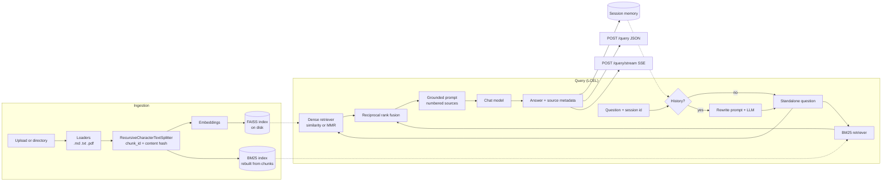

# langchain-rag-service

A FastAPI service for retrieval-augmented generation (RAG) built on LangChain runnables.
You give it Markdown, text or PDF files; it splits them into chunks and indexes them in
FAISS and BM25. Questions are answered from the retrieved chunks, with numbered
citations. Answers can be streamed over Server-Sent Events. Follow-up questions in a
session are rewritten into standalone questions before retrieval.

It runs with no API keys: the default `fake` provider uses deterministic hashing
embeddings and an extractive stand-in for the chat model, so the API, the tests and the
evaluation all run offline. Set `RAG_PROVIDER=openai` to use an OpenAI-compatible
endpoint, either OpenAI itself or a local Ollama server.

## Architecture



The query side is a composition of LangChain runnables:

- `build_rewrite_chain`: a `RunnableBranch` that returns the question unchanged on the
  first turn and runs `rewrite_prompt | llm | StrOutputParser` when there is history.
- `build_retrieval_chain`: `RunnablePassthrough.assign(standalone_question=...)` followed by
  `.assign(documents=itemgetter("standalone_question") | retriever)`.
- `build_answer_chain`: renders the documents into numbered `<source>` blocks, then
  `answer_prompt | llm | StrOutputParser`. A branch returns a fixed "not found" reply
  without calling the model when retrieval returned nothing.

The streaming endpoint runs the retrieval chain, sends the sources, and then streams the
answer chain with `astream`.

## Running locally

Requires Python 3.11 or newer.

```bash
python -m venv .venv
source .venv/bin/activate          # Windows: .venv\Scripts\activate
pip install -e ".[dev]"

RAG_INGEST_ON_STARTUP=data/docs rag-service
```

The service listens on `http://127.0.0.1:8000`; interactive docs are at `/docs`.
`RAG_INGEST_ON_STARTUP` ingests the sample corpus when the service starts. Sources that are
already indexed with identical content are skipped, so restarts do not re-embed them.

```bash
# Ingest more files
curl -F "files=@notes.md" -F "files=@manual.pdf" http://127.0.0.1:8000/ingest/files
curl -X POST http://127.0.0.1:8000/ingest/directory \
     -H "Content-Type: application/json" -d '{"path": "docs"}'

# Ask a question
curl -X POST http://127.0.0.1:8000/query \
     -H "Content-Type: application/json" \
     -d '{"question": "What value is the RRF constant k commonly set to?", "session_id": "demo"}'

# Stream the answer
curl -N -X POST http://127.0.0.1:8000/query/stream \
     -H "Content-Type: application/json" \
     -d '{"question": "What does the BM25 parameter k1 control?"}'
```

### Endpoints

| Method | Path | Purpose |
| --- | --- | --- |
| `GET` | `/health` | Provider, retriever mode and number of indexed chunks |
| `POST` | `/ingest/files` | Multipart upload of `.md`, `.markdown`, `.txt` or `.pdf` files |
| `POST` | `/ingest/directory` | Ingest a directory below `RAG_INGEST_ROOT` (`{"path": "docs"}`) |
| `GET` | `/documents` | Chunk count per source |
| `DELETE` | `/documents/{source}` | Remove one source from the index |
| `POST` | `/query` | Answer a question; returns JSON |
| `POST` | `/query/stream` | Answer a question as Server-Sent Events |
| `GET` | `/sessions/{id}` | Messages stored for a session |
| `DELETE` | `/sessions/{id}` | Forget a session |

`/query` and `/query/stream` accept `question`, an optional `session_id`, and optional
per-request overrides `k`, `retriever_mode` (`dense`, `bm25`, `hybrid`) and `search_type`
(`similarity`, `mmr`). The JSON response contains `answer`, `standalone_question` and
`sources`; each source has the citation `id` used in the answer, `source`, `page` for
PDFs, `chunk_id`, `start_index`, a `score` (RRF or BM25; none for dense search) and a
`snippet`.

The stream sends these events, each with a JSON `data` field:

| Event | Data |
| --- | --- |
| `sources` | `question`, `standalone_question`, `sources` (same shape as `/query`) |
| `token` | one chunk of answer text |
| `done` | `answer` (the full text) and `session_id` |
| `error` | `detail`, sent if generation fails after the stream started |

Querying an empty index returns `409 Conflict`.

## Docker

```bash
docker compose up --build
```

The image is a two-stage build on `python:3.13-slim` and runs as an unprivileged `app`
user (uid 10001). It ingests `data/docs` on startup and keeps the index in the `rag-var`
volume. To use a local Ollama server instead of the fake provider:

```bash
RAG_PROVIDER=openai docker compose --profile ollama up --build
docker compose exec ollama ollama pull llama3.2
docker compose exec ollama ollama pull nomic-embed-text
docker compose restart api
```

Compose gives each provider its own index directory (`/app/var/index-<provider>`), because
an index can only be queried with the embedding model that built it.

## Configuration

All settings are environment variables with the `RAG_` prefix; a `.env` file is also read.
Empty values count as unset.

| Variable | Default | Meaning |
| --- | --- | --- |
| `RAG_PROVIDER` | `fake` | `fake` (offline, deterministic) or `openai` (OpenAI-compatible API) |
| `RAG_OPENAI_BASE_URL` | unset | e.g. `http://localhost:11434/v1` for Ollama; unset means api.openai.com |
| `RAG_OPENAI_API_KEY` | unset | API key; with a non-OpenAI base URL a placeholder is sent |
| `RAG_CHAT_MODEL` | `gpt-4o-mini` | Chat model name |
| `RAG_EMBEDDING_MODEL` | `text-embedding-3-small` | Embedding model name |
| `RAG_TEMPERATURE` | `0.0` | Sampling temperature for the chat model |
| `RAG_INDEX_DIR` | `var/index` | Where the FAISS index is saved |
| `RAG_INGEST_ROOT` | `data` | `/ingest/directory` can only read below this directory |
| `RAG_INGEST_ON_STARTUP` | unset | Directory to ingest when the service starts |
| `RAG_MAX_UPLOAD_BYTES` | `10485760` | Per-file upload limit |
| `RAG_CHUNK_SIZE` / `RAG_CHUNK_OVERLAP` | `800` / `120` | Splitter settings, in characters |
| `RAG_RETRIEVER_MODE` | `hybrid` | `dense`, `bm25` or `hybrid` |
| `RAG_SEARCH_TYPE` | `similarity` | Dense search: `similarity` or `mmr` |
| `RAG_TOP_K` | `4` | Chunks passed to the model |
| `RAG_FETCH_K` | `20` | MMR candidate pool; also caps hybrid candidates |
| `RAG_MMR_LAMBDA` | `0.5` | MMR relevance/diversity balance |
| `RAG_RRF_K` | `60` | Reciprocal rank fusion constant |
| `RAG_DENSE_WEIGHT` / `RAG_BM25_WEIGHT` | `1.0` / `1.0` | Fusion weights |
| `RAG_MAX_HISTORY_MESSAGES` | `10` | Messages kept per session (`0` disables memory) |
| `RAG_HOST` / `RAG_PORT` | `127.0.0.1` / `8000` | Bind address |

In hybrid mode each retriever contributes up to `2 * k` candidates (capped at `fetch_k`)
before fusion trims the list to `k`.

## Evaluation

`rag-eval` indexes a directory into a temporary FAISS store with the configured provider
and runs a JSONL question set through each retriever mode. Each line names the source
files that count as relevant:

```json
{"question": "What does the k1 parameter control in BM25?", "relevant": ["bm25.md"]}
```

It reports hit rate@k (share of questions with a relevant chunk in the top k) and mean
reciprocal rank (mean of 1 / rank of the first relevant chunk, 0 when there is none).
`--misses` lists the questions that failed and `--json` prints per-question results.

The output below is a real run of `rag-eval -k 4` with the **fake provider** (hashing
embeddings, not a semantic model) over the 8 sample documents in `data/docs` and the 20
questions in `data/eval/questions.jsonl`. The question set is small and was written
alongside the documents, so these numbers only show that the pipeline works; they say
nothing about how the service performs on other data or with a real embedding model.

```text
provider: fake (hashing embeddings, dim 384)
chunks: size 800, overlap 120

mode     search       k questions hit_rate@k    mrr
---------------------------------------------------
dense    similarity   4        20      0.950  0.900
bm25     -            4        20      1.000  0.975
hybrid   similarity   4        20      0.950  0.900
```

The one miss for dense and hybrid is "Why can lexical search miss a passage that uses a
synonym?": the hashing embeddings only match shared words and character trigrams, so they
cannot connect "synonym" to the passage about paraphrases.

## Design decisions

- **Own RRF instead of `EnsembleRetriever`.** In LangChain 1.x, `EnsembleRetriever` and the
  history-aware retriever helpers moved to `langchain-classic`. The fusion here is a short
  function keyed on `chunk_id`, which makes deduplication explicit and lets a weight of
  zero switch a retriever off. The hybrid retriever runs both retrievers concurrently on
  the async path.
- **History-aware rewriting as plain LCEL.** A `RunnableBranch` does what
  `create_history_aware_retriever` did, without the classic package. History is stored as
  message lists and trimmed with `trim_messages` so it always starts on a user turn.
  `InMemoryChatMessageHistory` is not used because it is deprecated in current
  `langchain-core`.
- **Content-hash chunk ids.** Each chunk id is a hash of its source, position and text.
  Re-ingesting a file replaces its old chunks, and an unchanged file is skipped without
  calling the embedding model.
- **Copy-on-write index snapshots.** Writers update a copy of the FAISS store and swap in a
  new immutable snapshot (FAISS + chunk list + BM25) under a lock. A request keeps using
  the snapshot it started with.
- **One embedding model per index.** A `manifest.json` next to the index records the
  embedding model; loading it with a different model fails at startup instead of
  returning meaningless results.
- **Pickle safety.** LangChain's FAISS persistence uses a pickle file. The service only
  loads the directory it writes itself; uploaded files are parsed as text or PDF and
  never unpickled.
- **A fake provider that does something.** `HashingEmbeddings` hashes word and
  character-trigram features into a normalised vector, so related text ends up close and
  retrieval tests are meaningful offline. `ExtractiveFakeChatModel` answers with the
  source sentences that share the most words with the question and cites them, which
  keeps the response shape realistic and supports token streaming. It is not a language
  model and its answers are only as good as word overlap allows.
- **Ingestion is sandboxed.** Directory ingestion through the API is limited to
  `RAG_INGEST_ROOT`, uploaded file names are reduced to a bare name, and uploads have a
  size limit.

## Limitations

- Session history is kept in process memory: it is lost on restart and not shared
  between workers or replicas.
- The BM25 index is rebuilt from all chunks after every write, and each write copies the
  FAISS store. That is fine for small and medium corpora, not for millions of chunks.
- PDF text comes from `pypdf`; scanned PDFs without a text layer produce no chunks.
- The FAISS integration still comes from `langchain-community`, which upstream has
  marked as sunsetting; it prints a deprecation warning on import.
- There is no authentication; put the service behind something that provides it before
  exposing it beyond your machine.

## Project layout

```text
src/rag_service/
  config.py       settings (pydantic-settings, RAG_* variables)
  ingestion.py    loaders for text, Markdown and PDF; splitter; chunk ids
  text.py         tokenizer and sentence splitter shared by BM25 and the fake models
  providers.py    hashing embeddings, extractive fake chat model, OpenAI-compatible factory
  store.py        FAISS + BM25 index snapshots, persistence, per-source replacement
  retrieval.py    BM25 retriever, reciprocal rank fusion, hybrid retriever, MMR options
  prompts.py      grounded answer prompt, rewrite prompt, context formatting
  chain.py        LCEL rewrite, retrieval and answer chains
  memory.py       per-session message history
  service.py      wires everything together; blocking and streaming answers
  api.py          FastAPI app and SSE endpoint
  evaluation.py   rag-eval CLI: hit rate@k and MRR
  __main__.py     rag-service entry point (uvicorn)
data/docs/        sample corpus
data/eval/        evaluation questions
tests/            pytest suite (runs on the fake provider)
```

## Development

```bash
ruff check .
ruff format --check .
pytest
```

## License

MIT, see [LICENSE](LICENSE).
